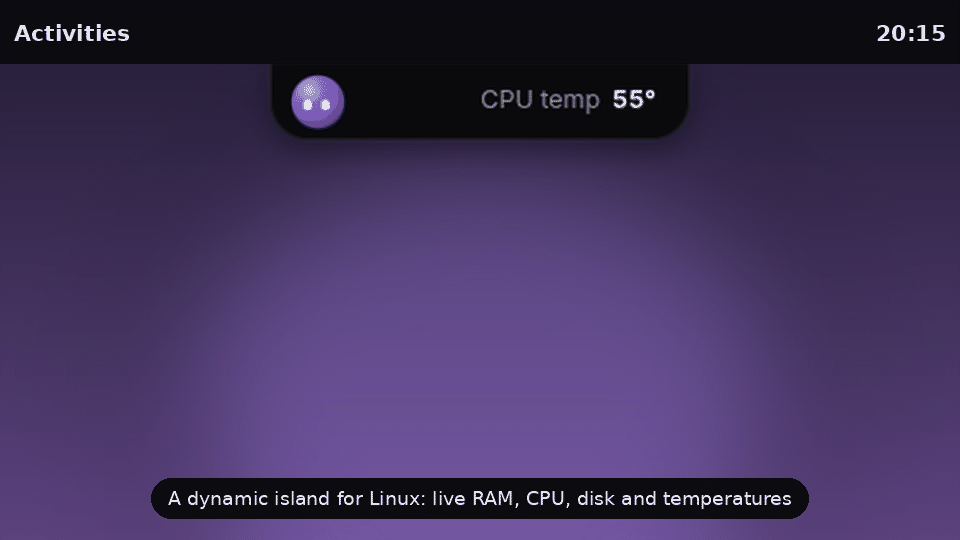

<p align="center">
  
</p>

<h1 align="center">Lydia</h1>

<p align="center">A friendly desktop companion for Linux that lives at the top of your screen, like a dynamic island.</p>

<p align="center">
  
</p>

## What she does

- **Live system stats** in a small pill: RAM, CPU, disk, CPU and GPU temperature (AMD, Intel and NVIDIA).
- **Opens when you reach for her**: move the mouse to the top of the screen and come down onto her.
- **Warns you** about stuck processes, heat and low memory, with buttons to end or ignore them, and a task manager.
- **Talk to her** (Super+Alt+Space or the mic button): she opens apps and sites, searches, sets the volume, controls music, sets timers, locks the screen, switches the theme, and answers questions out loud. Everyday commands work offline; speech is transcribed on your computer with whisper.cpp and never saved. Actions that could lose work (closing an app) ask first.
- **Temporary chat** with Claude (your Claude account, through the `claude` command), Gemini (a free Google AI Studio key, kept in the system keyring) or a local Ollama model. Nothing is saved.
- **Notifications that say what arrived**, and stay in the pill until you look.
- **Stays out of the way**: a thin handle under a maximized window, a small notch in fullscreen, and she can hide during Steam games.
- **Idle life**: she naps, reads, plays, waters her plant, solves a Rubik's cube, draws, has coffee in the morning and lunch at noon, and listens along when music plays. No mouth: she says everything with her eyes.
- **Your colors**, and **English, Portuguese (Brazil) and Spanish**.
- **A setup wizard** on first run: language, chat engine, Claude login, Gemini key, the GNOME extension and start on login.

## Running it

Requirements: Linux, Node.js 20+, Python 3. On X11 she uses `xprop` and `xdotool`; on GNOME (X11 or Wayland) the bundled GNOME Shell extension does that job. The `claude` command, Ollama and a Gemini key are all optional (one of them is enough for the chat).

```bash
npm install
npm start
```

The setup wizard opens the first time. You can reopen it from her menu (right-click her): **Set up Lydia…**

```bash
npm test
```

## Desktops

| Desktop | Status |
| --- | --- |
| GNOME on X11 | Works (with or without the extension) |
| GNOME on Wayland | Works with the Lydia helper extension (`gnome-extension/`) |
| Other X11 desktops | Mostly works |
| KDE Plasma on Wayland, others | Not yet: she runs, but can't see the pointer or fullscreen windows |

## Privacy

Everything runs on your computer. System numbers come from `/proc` and `/sys`. Chat messages only go to the engine you pick. The GNOME extension only talks to Lydia, over your session's D-Bus.

## Roadmap

See [ROADMAP.md](ROADMAP.md): packaging (AppImage, .deb, Flatpak) is next.
