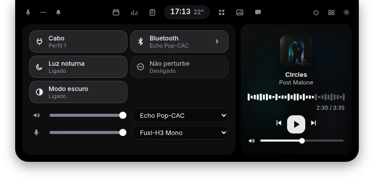
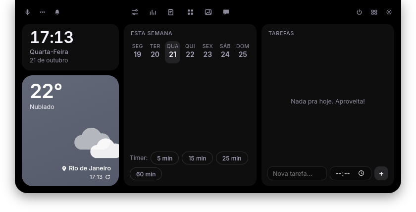
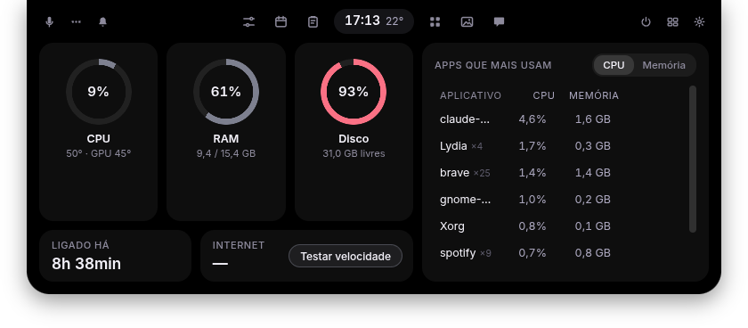
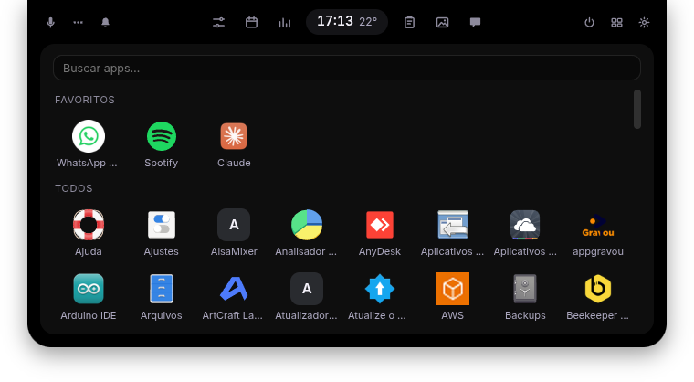
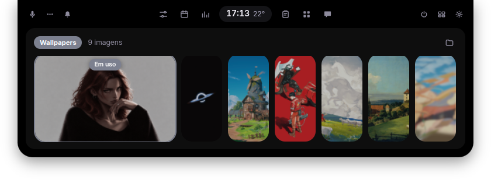
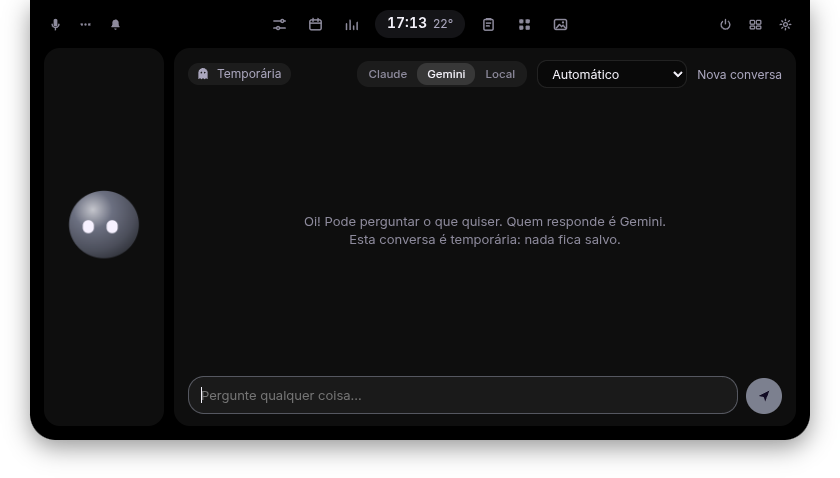

<p align="center">
  
</p>

<h1 align="center">Lydia</h1>

<p align="center">A workstation for Linux that lives at the top of your screen, like a dynamic island.<br>
Everything you reach for is one move of the mouse (or the Super key) away.</p>

<p align="center">
  
  
  
  
  
  
</p>

## What it does

**Closed**, it is a small black island at the top center: a clock and/or your system's numbers (RAM, CPU, disk, temperature) in turns. When something plays (and nothing is below it) it becomes a small player: the cover blurred behind, previous/next, that app's own volume, and a progress bar that dances with the sound. Over a maximized window it shrinks to a thin handle; in fullscreen, to a small notch.

**Open** (hover it, or press Super), it is a set of tabs around a clock with the temperature:

- **Controls**: Wi-Fi and Bluetooth (on/off, and a list to connect to networks and devices), night light, do not disturb, dark mode, sound output and microphone with their levels, screen brightness, and the player.
- **Today**: a big clock, the weather where you are, the week, timers, and tasks with a time (she reminds you, out loud too).
- **System**: CPU, RAM and disk rings, temperatures, uptime, a speed test, and the busiest apps (end one with two clicks).
- **Clipboard**: what you copied (text and images), with search, pinning, pause; passwords and keys are never kept. Click to paste.
- **Apps**: every installed app, in your language, with search and favorites (right click).
- **Wallpapers**: from a folder of yours, applied with a click.
- **Chat**: talk to Lydia (Claude, Gemini or a local Ollama model). Nothing is saved.
- **Notifications** (the bell): WhatsApp, Discord, everything the system received; open or dismiss them.
- **Power**, the **workspaces** overview, and **settings** (look, language, font, the closed bar, voice, the Super key).

**Voice**: press Super+Alt+Space and talk. She opens apps and sites, plays music on Spotify or YouTube, sets the volume, timers, the theme, locks the screen, and answers out loud with a natural voice (Gemini) or a local one (Kokoro). After answering she keeps listening for a moment, so you can just reply.

**Dictation**: press Super+Alt+D, talk, and the cleaned-up text is typed where you are.

**On GNOME** her helper extension can also hide GNOME's top bar (she takes its place) and give her the Super key.

Languages: English, Portuguese (Brazil) and Spanish.

## Installing (Ubuntu 24.04 and newer)

Build the package and install it (it pulls in what it needs):

```bash
npm install
npm run dist
sudo apt install ./dist/lydia_1.0.0_amd64.deb
```

Then open **Lydia** from the apps menu; the setup wizard can make her start on login.

## Running from the source

Requirements: Linux, Node.js 20+, Python 3 with GTK bindings (`python3-gi`), PipeWire (`wpctl`, `pw-record`) and the usual desktop tools (`pactl`, `nmcli`, `bluetoothctl`, `gdbus`, `gsettings`). On X11 she also uses `xprop` and `xdotool`. The `claude` command, Ollama and a Gemini key are optional (one of them is enough for the chat; the Gemini key also gives her the natural voice).

```bash
npm install
npm start
```

A setup wizard opens the first time (language, chat engine, voice, the GNOME extension, start on login). You can reopen it from her menu (the three dots): **Set up Lydia…**

```bash
npm test
```

## Desktops

| Desktop | Status |
| --- | --- |
| GNOME 45+ (X11 or Wayland) with the Lydia helper extension (`gnome-extension/`) | Everything, including hiding the top bar, the Super key and notifications |
| GNOME on X11 without the extension | Works, without those three |
| Other X11 desktops | The island and most tabs work; switches that use GNOME settings (dark mode, night light, do not disturb, wallpaper) don't |
| KDE Plasma on Wayland, others | Not yet: she runs, but can't see the pointer or fullscreen windows |

Tested on Zorin OS 18 (GNOME 46, X11), from the source and as the built package.

## Privacy

Everything runs on your computer and nothing is recorded. What leaves it, and only when you use it:

- **Chat and the natural voice**: the engine you pick (Claude, or Gemini with your own key).
- **Weather**: [Open-Meteo](https://open-meteo.com); the city is the one you type in settings, or a rough one from your internet address ([ipwho.is](https://ipwho.is)).
- **Speed test**: Cloudflare. **Playing a song on Spotify**: a DuckDuckGo search for its link.

Voice is transcribed on your computer (whisper.cpp). The visualizer listens to the sound output only while a player is on screen. The GNOME extension only talks to Lydia, over your session's D-Bus.

## Roadmap

See [ROADMAP.md](ROADMAP.md).
